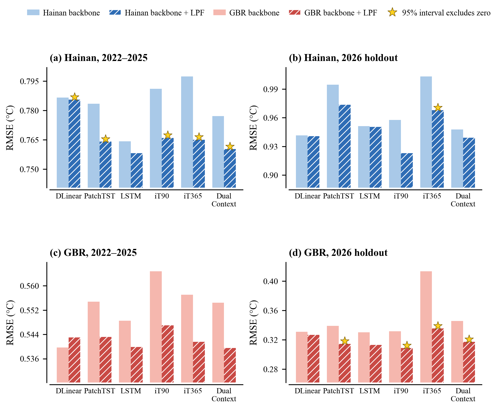

# ReefFormer: Lead-Dependent Forecast Fusion for 1–30-Day Satellite SST Prediction

<p align="center">
  
</p>

<p align="center">
  <b>A transparent, low-cost fusion framework that allocates predictive information by forecast lead</b><br/>
  for daily sea surface temperature (SST) prediction in reef-adjacent coastal waters.
</p>

<p align="center">
  
  
  
  
</p>

<p align="center">
  
  
  
  
</p>

---

## Overview

Daily satellite SST forecasts for individual coastal cells support reef
monitoring, field operations, and marine protection. Data-driven forecasters
are usually configured once by an aggregate score and applied unchanged at
every lead. Around Hainan Island, however, the most accurate source of
information changes within the 1–30-day horizon: a short history and damped
persistence lead in the first week, a long history and learned models
thereafter.

**ReefFormer** turns this lead-dependent structure into accuracy. Two
independently trained regional iTransformer branches (90- and 365-day context)
are merged by **Lead-dependent Context Fusion (LCF)**, and **Lead-dependent
Persistence Fusion (LPF)** blends damped anomaly persistence into the learned
forecast with a weight that decays with lead. Each module is a smooth monotone
curve with two coefficients, fitted on validation forecasts only.

## Quick Navigation

- [Highlights](#highlights)
- [Architecture](#architecture)
- [Update Log](#update-log)
- [Paper Access](#paper-access)
- [Datasets](#datasets)
- [Performance Comparison](#performance-comparison)
- [Project Structure](#project-structure)
- [Quick Start](#quick-start)
- [Weights](#weights)
- [Usage Notes](#usage-notes)
- [Citation](#citation)
- [License](#license)
- [Contact](#contact)

## Highlights

| Sticker | Detail |
| --- | --- |
| `🌊 Lead-aware` | Relative skill reorders with lead in two independent reef regions; ReefFormer allocates information accordingly. |
| `🔌 Plug-in LPF` | The persistence module attaches to any learned forecast and lowers RMSE in **23 of 24** backbone, period, and region comparisons. |
| `🎯 Accurate` | Lowest Hainan RMSE among external baselines over 2022–2025 (**0.7602 °C**) and lowest point-estimate RMSE on a frozen 2026 holdout (**0.9390 °C**). |
| `⚡ Low cost` | **0.0227 GFLOPs** per sample, about one-fourteenth of PatchTST; fusion adds only four scalars. |
| `🔒 Leakage-controlled` | Chronological Train / Val / Dev / Test2026 split; every coefficient is frozen before any evaluation year is used. |

## Architecture

<p align="center">
  
</p>

- `🧩 Regional iTransformer branches`: each of the 90-day and 365-day branches
  treats every pixel time series as a variate token, so cross-pixel dependencies
  are modelled within the branch.
- `🔀 LCF`: shifts weight from the short-context to the long-context branch as
  lead increases, `q(h) = a_c + (1 - a_c) · exp(-h/τ_c)`.
- `🧭 LPF`: blends damped anomaly persistence into the fused learned forecast
  with a lead-decaying weight, `w(h) = a_p + (1 - a_p) · exp(-h/τ_p)`.
- `📦 Backbone-agnostic`: fusion operates on complete forecasts and needs no
  retraining of the constituent predictors (see `src/reefformer/fusion.py`).

### Snapshot

| Item | Value |
| --- | --- |
| Main task | Direct 1–30-day satellite SST prediction |
| Study domains | 154 Hainan cells and 292 Great Barrier Reef cells |
| Core method | Two context branches followed by persistence fusion |
| Fusion coefficients | Four, fitted on validation forecasts |
| Public reproduction data | Great Barrier Reef CoralTemp v3.1 |

## Update Log

- `🔜 To appear`: paper link and final citation after publication.
- `2026/10/14`: Repository package prepared with source code, the Great
  Barrier Reef data, and six archived checkpoints. Publication and submission
  status will be updated when confirmed.

## Paper Access

*Lead-Dependent Forecast Fusion for 1–30-Day Satellite Sea Surface Temperature
Prediction in Reef-Adjacent Coastal Waters* (research manuscript). A public article link will be
added when available.

## Datasets

| Dataset | Scale | Description | Access |
| --- | --- | --- | --- |
| `GBR CoralTemp` | 292 pixels, 2000–2026 | Central Great Barrier Reef, independently selected replication domain | `📂 Included` |
| `Hainan CoralTemp` | 154 pixels, 2000–2026 | Reef-adjacent cells around Hainan Island (main study domain) | `📬 On request` |
| `Hainan OSTIA` | 154 pixels | Second-product replication around Hainan Island | `📬 On request` |

All domains share the same chronological split: Train 2000–2017, Val
2018–2021, Dev 2022–2025, and a frozen 2026 holdout.

### Dataset Access

- `📂 Included`: GBR input data and the six iTransformer branch checkpoints are
  included for the principal ReefFormer reproduction workflow. The full set
  of paper baselines and exploratory experiments is not bundled here.
- `📬 Academic usage`: the Hainan datasets and checkpoints are available for
  academic, non-commercial research on request to the corresponding author.
  File layout and SHA-256 hashes are listed in [`docs/DATA.md`](docs/DATA.md).

## Performance Comparison

RMSE (°C), lower is better. Learned models are means over seeds 42–44.

**Hainan Island (154 pixels)**

| Model | Dev 2022–2025 | Frozen 2026 |
| --- | --- | --- |
| DAP (damped persistence) | 0.8326 | 1.0082 |
| DLinear | 0.7865 | 0.9415 |
| PatchTST | 0.7835 | 0.9946 |
| iTransformer | 0.7973 | 1.0030 |
| LSTM | 0.7642 | 0.9512 |
| **ReefFormer** | **0.7602** | **0.9390** |

**Great Barrier Reef (292 pixels, reproducible from this repository)**

| Model | Dev 2022–2025 | Frozen 2026 |
| --- | --- | --- |
| DAP (damped persistence) | 0.6203 | 0.3418 |
| DLinear | 0.5397 | 0.3308 |
| PatchTST | 0.5548 | 0.3389 |
| iTransformer (365-day context, as selected around Hainan) | 0.5570 | 0.4132 |
| iTransformer (90-day branch, favored by GBR validation) | 0.5648 | 0.3315 |
| LSTM | 0.5485 | 0.3302 |
| **ReefFormer** | **0.5395** | **0.3170** |

DLinear, PatchTST, and the LSTM use the 90-day context selected on GBR validation
RMSE. The two iTransformer contexts are preregistered ReefFormer components on the
GBR, so both are listed (see Table S27 of the supplementary material).

<p align="center">
  
</p>

## Project Structure

```bash
ReefFormer-SST
|-- README.md
|-- LICENSE
|-- CITATION.cff
|-- pyproject.toml / requirements.txt / environment.yml
|-- assets                     # figures used in this README
|-- src/reefformer
|   |-- fusion.py              # LCF and LPF: fit, apply, damped persistence
|   |-- itransformer.py        # compact regional iTransformer branch
|   `-- metrics.py
|-- scripts
|   |-- run_demo.py            # synthetic example, runs in seconds
|   |-- reproduce_reference.py # reload checkpoints, refit fusion, verify tables
|   |-- train_backbone.py      # retrain one branch under the archived protocol
|   `-- audit_release.py
|-- data
|   |-- processed/gbr_coraltemp_daily.npz
|   `-- inventories/gbr_coraltemp_pixels.csv
|-- checkpoints/gbr_coraltemp  # 90/365-day branches, seeds 42-44
|-- reference_results/gbr_coraltemp
|-- docs                       # install, data access, user guide, reproducibility
`-- tests
```

## Quick Start

### 1. Install

```bash
python -m venv .venv
# Windows: .venv\Scripts\activate    Linux/macOS: source .venv/bin/activate
python -m pip install --upgrade pip
python -m pip install -e ".[test]"
```

### 2. Run the synthetic demo and tests

```bash
python scripts/run_demo.py
pytest
```

### 3. Reproduce the GBR results

```bash
python scripts/reproduce_reference.py --domain gbr_coraltemp --device auto
```

This reloads the six archived branches, fits LCF and LPF on 2018–2021
validation forecasts only, scores 2022–2025 and 2026, and checks the result
against `reference_results/gbr_coraltemp/` (tolerance 1e-4 °C).

### 4. Use LPF with your own forecaster

```python
from reefformer import fit_reef_former, apply_reef_former

params = fit_reef_former(short_val, long_val, persistence_val, truth_val)
forecast = apply_reef_former(short_test, long_test, persistence_test, params)
```

Arrays are shaped `[forecast_origin, lead, spatial_unit]` in anomaly units. See
[`docs/USER_GUIDE.md`](docs/USER_GUIDE.md).

## Weights

- `🏷️ Release weights`: `checkpoints/gbr_coraltemp/iT_L{90,365}_seed{42,43,44}.pt`
- Hainan weights are distributed with the Hainan datasets on request.

## Usage Notes

- [`docs/INSTALL.md`](docs/INSTALL.md) covers installation and environment setup.
- [`docs/USER_GUIDE.md`](docs/USER_GUIDE.md) explains the fusion inputs and API.
- [`docs/REPRODUCIBILITY.md`](docs/REPRODUCIBILITY.md) gives the archived
  protocol and the results this package reproduces.
- [`docs/DATA.md`](docs/DATA.md) records data provenance, attribution, and
  how to request the Hainan artifacts.
- This package supports the principal Great Barrier Reef ReefFormer
  reproduction. The full set of paper baselines and exploratory experiments
  is not bundled here.

## Citation

```bibtex
@misc{reefformer2026,
  title  = {Lead-Dependent Forecast Fusion for 1--30-Day Satellite Sea Surface Temperature Prediction in Reef-Adjacent Coastal Waters},
  author = {ReefFormer contributors},
  year   = {2026},
  note   = {Research manuscript. Code: https://github.com/Luyujun0608/ReefFormer-SST}
}
```

## License

Released under the GNU Affero General Public License v3.0; see `LICENSE`. Data
sources keep their own terms; see [`docs/DATA.md`](docs/DATA.md).

## Contact

For collaboration, Hainan data requests, or comparison experiments:

- **GitHub:** [Luyujun0608](https://github.com/Luyujun0608)
- **Data requests:** open a GitHub issue to arrange contact with the authors;
  do not post private contact information or restricted data in a public issue.
